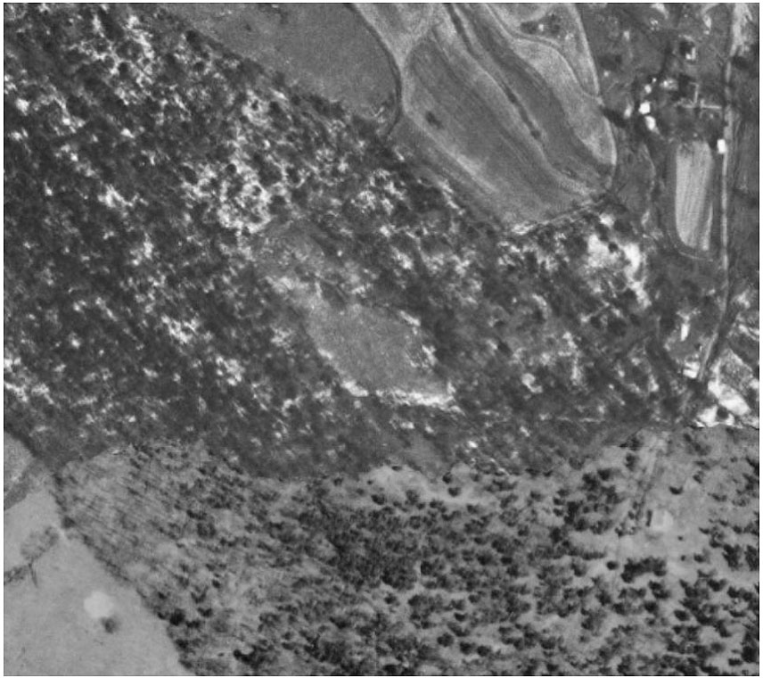

## by Ed Ralston

  <blockquote>
    
This ridge, today known as “Huntington Ridge”, had no known name before land developers dubbed it as such. I had previously written about how this ridge was part of the land owned by Will McMurray’s Twin Springs Dairy operations and that evidence suggested that the name “Twin Springs” came from two springs that originated on this property.

    
But the ridge <b>held another secret ...</b>

    
<i>Continue reading <a href="/assets/docs/publications/The-Diamond-on-the-Ridge.pdf">The Diamond on the Ridge</a></i>

  </blockquote>
  

